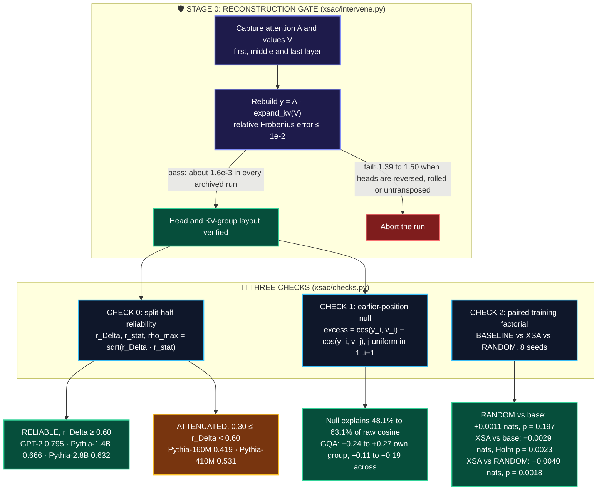
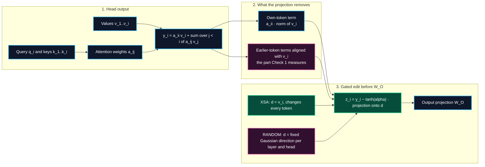
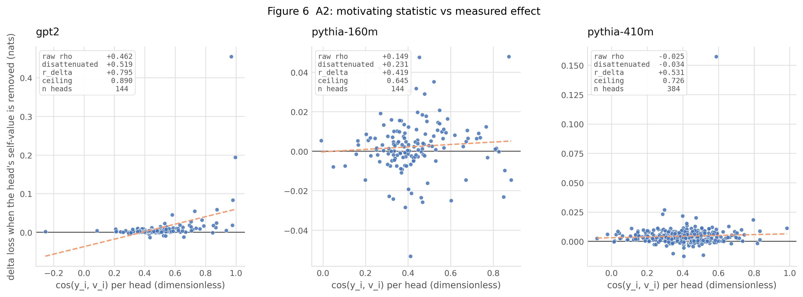
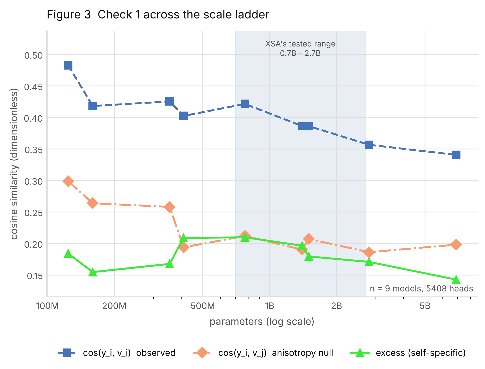
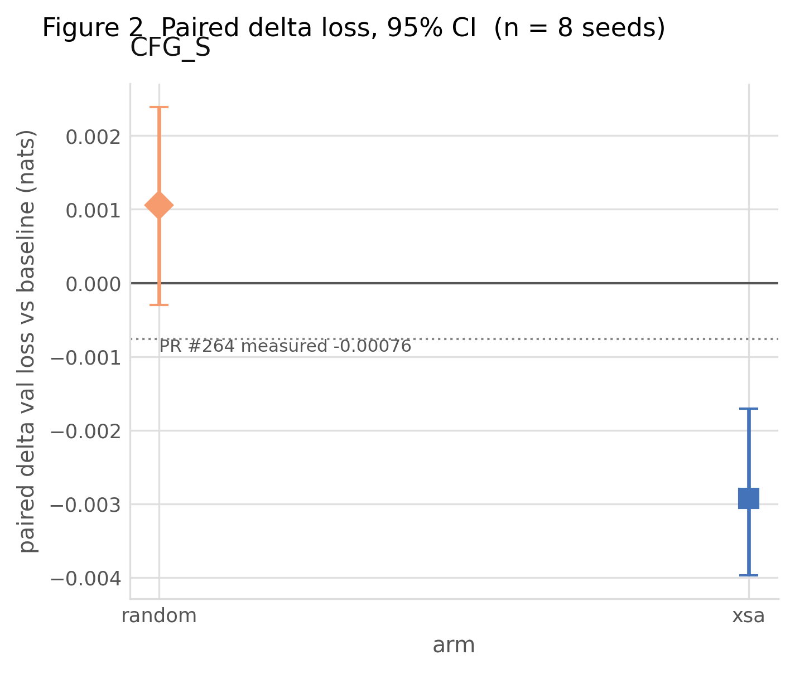
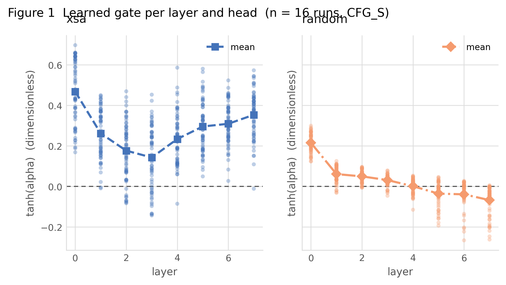
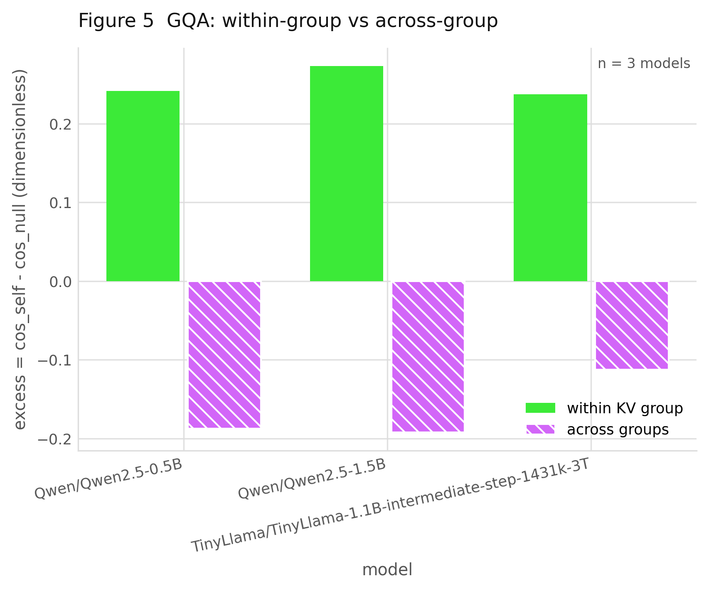
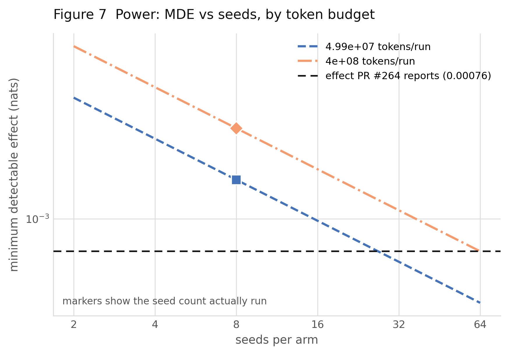
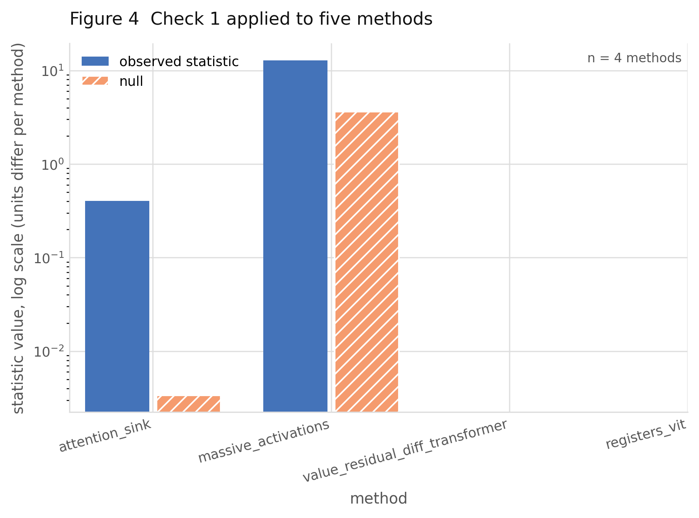
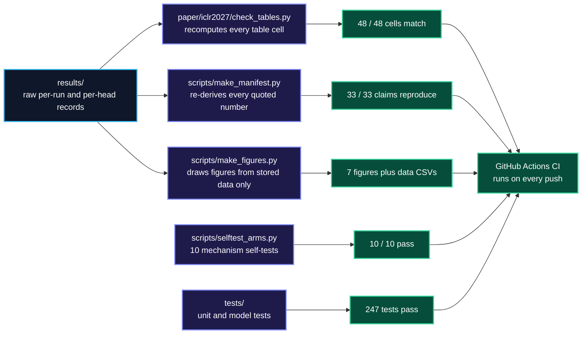

<div align="center">

# 🧠 Sanity Checks for Attention Surgery
### *Null Models and Matched Interventions for Representation-Motivated Design*

**Basavaraj R M** · **Aryan Bharat Kumar** · [arXiv:2611.13543](https://arxiv.org/abs/2611.13543) 

<p align="center">
  <b>Check 0: Is the effect resolvable?</b> &nbsp;•&nbsp;
  <b>Check 1: Does alignment beat a geometric null?</b> &nbsp;•&nbsp;
  <b>Check 2: Does the training gain need that direction?</b>
</p>

<p align="center">
    <a href="https://arxiv.org/abs/2611.13543"></a>
  <a href="https://doi.org/10.5281/zenodo.24096410"></a>
  <a href="https://github.com/Basavarajearlybird/SANITY-CHECKS-FOR-ATTENTION-SURGERY_Original/actions/workflows/ci.yml"></a>
  <a href="LICENSE"></a>
</p>
<p align="center">
  
  
  
  
</p>
<p align="center">
  
  
  
</p>

---

### ⚡ Results at a Glance

| Check | Question | Setup | Key Result | Verdict |
| :--- | :--- | :--- | :--- | :--- |
| **Check 0: Resolvability** | Is the per-head intervention effect measured reliably? | Split-half, 64 docs/half, `T = 128`; GPT-2, Pythia-160M, Pythia-410M | **r<sub>Δ</sub> = 0.795** (GPT-2), **0.419** (160M), **0.531** (410M); **r<sub>stat</sub> ≥ 0.991** | Reliable in GPT-2, attenuated in Pythia; which statistic predicts the effect is **model-dependent** |
| **Check 1: Geometric Null** | Does cos(y<sub>i</sub>, v<sub>i</sub>) exceed the earlier-position null? | 9 multi-head models, **5,408 heads**, 124M–6.9B; 3 GQA models | Null explains **48.1%–63.1%** of raw alignment; excess **0.14–0.21**, no monotone scale trend | Large alignment is **largely background geometry**; GQA excess is **+0.24 to +0.27** within group, **−0.11 to −0.19** across |
| **Check 2: Matched Control** | Does the training gain need the own-value direction? | Pre-registered **3 arms × 8 seeds**, **399,900,672 tokens/run**, 50.9M params | `RANDOM` vs. baseline **+0.0011 nats** (*p* = 0.197); `XSA` vs. baseline **−0.0029 nats** (Holm *p* = 0.0023) | `XSA` beats `RANDOM` directly by **−0.0040 nats** (*p* = 0.0018) |

</div>

---

## 🏛️ The Audit Pipeline



---

## 📖 Overview

Transformer modifications often follow one pattern: measure a statistic inside the model, observe that it is large, remove it architecturally, and report an improvement. Reading that chain correctly needs three questions answered, which this repository turns into reusable checks:

1. **Check 0, resolvability.** Is the behavioural effect of the edit measured reliably enough to correlate with anything? A weak correlation between a statistic and a noisy effect cannot be read as "no relationship".
2. **Check 1, geometric null.** Is the statistic larger than what shared background geometry already produces? We compare cos(y<sub>i</sub>, v<sub>i</sub>) with cos(y<sub>i</sub>, v<sub>j</sub>) for a partner *j* drawn from earlier positions in the same sequence.
3. **Check 2, matched control.** Does a training gain require the specific direction removed, or would any rank-one edit with the same gate do? We train self-directed and fixed arbitrary-direction arms against a shared baseline on paired seeds.

We apply all three to **Exclusive Self-Attention (XSA)** ([Zhai, 2026](https://arxiv.org/abs/2603.09078)), which removes the component of each head's output aligned with its own value vector.

You can apply the same checks to your own method:

```python
from xsac.checks import check_resolvability, check_null, check_matched
```

See [`examples/audit_your_method.py`](examples/audit_your_method.py) for a complete worked example that runs on CPU.

---

## 📑 Table of Contents

- [1. Method](#-1-method)
- [2. Experimental Setup](#-2-experimental-setup)
- [3. Results](#-3-results)
- [4. Figures](#-4-figures)
- [5. How Every Number Is Verified](#-5-how-every-number-is-verified)
- [6. Repository Map](#-6-repository-map)
- [7. Install, Verify and Reproduce](#-7-install-verify-and-reproduce)
- [8. Scope and Limitations](#-8-scope-and-limitations)
- [9. Citation](#-9-citation)

---

## 🔬 1. Method

### 1.1 The intervention

Let head *h* at layer *ℓ* produce output **y<sub>i</sub>** at position *i*, and let **v<sub>i</sub>** be the value that head writes at *i*, with **v̂<sub>i</sub> = v<sub>i</sub> / ‖v<sub>i</sub>‖**. The edit, applied before the output projection, is:

> **z<sub>i</sub> = y<sub>i</sub> − tanh(α) ⟨y<sub>i</sub>, v̂<sub>i</sub>⟩ v̂<sub>i</sub>**

* **Frozen models:** the multiplier is fixed at 1, one head is edited at a time, and the first token is excluded (its output equals its own value).
* **Trained factorial:** gates start at zero, so every arm equals the baseline at step 0, and are learned with the model at every position.
* **Numerical stabilisation:** directions use **v<sub>i</sub> / (‖v<sub>i</sub>‖ + ε)**, with ε = 10<sup>−8</sup> frozen and 10<sup>−6</sup> in training.



Because earlier values can align with **v̂<sub>i</sub>**, this projection is not the same as deleting the attention diagonal, and it is not whole-head pruning.

### 1.2 The arms (`xsac/arms.py`)

| Arm | Direction removed | In the reported factorial? |
| :--- | :--- | :---: |
| `baseline` | none | ✅ |
| `xsa` | the head's own value **v̂<sub>i</sub>**, per token | ✅ secondary endpoint |
| `random` | a fixed Gaussian direction per layer and head, seeded by layer | ✅ **primary endpoint** |
| `meanval` | a detached moving average of the head's batch-mean value | implemented, not run |
| `diagmask` | gated down-weighting of the attention diagonal before softmax | implemented, not run |

### 1.3 The three checks

| Check | Statistic | Decision rule |
| :--- | :--- | :--- |
| **Check 0** | Split-half Spearman reliabilities **r<sub>Δ</sub>** (effect) and **r<sub>stat</sub>** (statistic); **ρ<sub>max</sub> = √(r<sub>Δ</sub> r<sub>stat</sub>)**, **ρ<sub>disatt</sub> = ρ<sub>raw</sub> / ρ<sub>max</sub>** | reliable **r<sub>Δ</sub> ≥ 0.60**; attenuated **0.30–0.60**; unresolvable **< 0.30** |
| **Check 1** | **excess = mean[cos(y<sub>i</sub>, v<sub>i</sub>) − cos(y<sub>i</sub>, v<sub>j</sub>)]**, *j* uniform over earlier positions, first token excluded | the statistic survives if excess stays clearly above zero |
| **Check 2** | Paired seed differences **Δ<sub>s</sub> = L<sub>arm</sub>(s) − L<sub>base</sub>(s)**; two-sided paired *t*, bootstrap 95% CI, Holm on secondaries; realised **MDE = 2.9 σ<sub>paired</sub> / √n** | primary endpoint is `RANDOM` vs. baseline, pre-registered |

### 1.4 The reconstruction gate

A layout bug can keep tensor shapes correct while editing the wrong head. Before any head is measured, the harness rebuilds **y = A · expand_kv(V)** from the captured attention and values on the first, middle and last layers and aborts if the relative Frobenius error exceeds **10<sup>−2</sup>** or is non-finite. The correct Pythia-160M layout gives **2.0 × 10<sup>−4</sup>**; reversed, rolled or untransposed heads give **1.39–1.50**. Every archived reliability run passed at about **1.6 × 10<sup>−3</sup>**.

---

## 🧪 2. Experimental Setup

| Experiment | Models | Size | Heads | Data and protocol |
| :--- | :--- | :---: | :---: | :--- |
| **Check 1, multi-head ladder** | GPT-2 (S/M/L/XL), Pythia (160M, 410M, 1.4B, 2.8B, 6.9B) | 124M–6.9B | **5,408** | WikiText-103 test, 32 docs, block 512, revision-pinned |
| **Check 1, grouped-query** | Qwen2.5-0.5B, Qwen2.5-1.5B, TinyLlama-1.1B | 0.5B–1.5B | **1,376** (12–32 query heads per layer) | own vs. neighbouring KV group |
| **Check 0, main** | GPT-2, Pythia-160M, Pythia-410M | 124M–410M | 144, 144, 384 | 64 docs per half, fixed `T = 128` |
| **Check 0, extended** | Pythia-1.4B, Pythia-2.8B | 1.4B–2.8B | 384, 1,024 | 32 docs per half, `T = 128`, bfloat16 |
| **Check 2, factorial** | Decoder-only, 8 layers, 8 heads, width 512 | **50.9M** | 64 per model | FineWeb-Edu sample-10BT; seeds 7, 42, 99, 512, 1337, 2024, 8191, 31337; **399,900,672 tokens per run** |

Within each seed, all three arms share initialisation, token order, learning-rate schedule and validation batches, so seed-level variation cancels in the paired difference. The completed factorial cost **$15.58** against a $20 ceiling (16.98 GPU-hours of training cells).

---

## 📊 3. Results

### 3.1 Check 0: resolvability

**Table 1. Split-half reliability** (64 docs per half, `T = 128`)

| Model | Heads | r<sub>Δ</sub> | r<sub>stat</sub> | ρ<sub>max</sub> | Verdict |
| :--- | :---: | :---: | :---: | :---: | :---: |
| **GPT-2** | 144 | `0.795` | `0.997` | `0.890` | ✅ reliable |
| **Pythia-160M** | 144 | `0.419` | `0.994` | `0.645` | ⚠️ attenuated |
| **Pythia-410M** | 384 | `0.531` | `0.991` | `0.726` | ⚠️ attenuated |

**Table 2. Does the statistic predict the effect?** (Spearman across heads; raw and disattenuated)

| Model | Statistic | ρ<sub>raw</sub> | ρ<sub>max</sub> | ρ<sub>disatt</sub> |
| :--- | :--- | :---: | :---: | :---: |
| **GPT-2** | self-cosine | `+0.462` | `0.890` | `+0.519` |
| | excess | `+0.279` | `0.891` | `+0.313` |
| **Pythia-160M** | self-cosine | `+0.149` | `0.645` | `+0.231` |
| | excess | `+0.189` | `0.646` | `+0.292` |
| **Pythia-410M** | self-cosine | `−0.025` | `0.726` | `−0.034` |
| | excess | `+0.249` | `0.727` | `+0.342` |

**Table 4. Extended reliability** (32 docs per half, `T = 128`, bfloat16; gate error 1.66 × 10<sup>−3</sup>)

| Model | Statistic | r<sub>Δ</sub> | r<sub>stat</sub> | ρ<sub>max</sub> | ρ<sub>raw</sub> | ρ<sub>disatt</sub> | Verdict |
| :--- | :--- | :---: | :---: | :---: | :---: | :---: | :---: |
| **Pythia-1.4B** | self-cosine | `0.666` | `0.982` | `0.809` | `+0.187` | `+0.232` | ✅ reliable |
| | excess | | `0.988` | `0.811` | `+0.249` | `+0.307` | |
| **Pythia-2.8B** | self-cosine | `0.632` | `0.967` | `0.782` | `+0.003` | `+0.003` | ✅ reliable |
| | excess | | `0.982` | `0.788` | `−0.124` | `−0.158` | |

> **Takeaway.** The structural statistic is measured almost perfectly everywhere (**r<sub>stat</sub> ≥ 0.967**); the bottleneck is the single-head effect. Even when the effect is reliable, as in Pythia-2.8B, self-cosine does not predict it (**ρ<sub>disatt</sub> = +0.003**).

### 3.2 Check 1: geometric null across scale

**Per-model ladder** (WikiText-103, block 512; null share = null ÷ observed)

| Model | Heads | cos(y<sub>i</sub>, v<sub>i</sub>) | Null cos(y<sub>i</sub>, v<sub>j</sub>) | Excess | Null share |
| :--- | :---: | :---: | :---: | :---: | :---: |
| GPT-2 (124M) | 144 | `0.483` | `0.299` | `0.184` | `61.9%` |
| Pythia-160M | 144 | `0.418` | `0.264` | `0.154` | **`63.1%`** |
| GPT-2 Medium (355M) | 384 | `0.425` | `0.258` | `0.167` | `60.6%` |
| Pythia-410M | 384 | `0.402` | `0.194` | `0.209` | **`48.1%`** |
| GPT-2 Large (774M) | 720 | `0.421` | `0.212` | `0.210` | `50.3%` |
| Pythia-1.4B | 384 | `0.386` | `0.190` | `0.196` | `49.2%` |
| GPT-2 XL (1.5B) | 1,200 | `0.386` | `0.207` | `0.179` | `53.6%` |
| Pythia-2.8B | 1,024 | `0.356` | `0.186` | `0.171` | `52.2%` |
| Pythia-6.9B | 1,024 | `0.340` | `0.198` | `0.143` | `58.1%` |

**Grouped-query attention** (both values subtract the own-group earlier-position null)

| Model | Query / KV heads per layer | Within-group excess | Across-group excess |
| :--- | :---: | :---: | :---: |
| Qwen2.5-0.5B | 14 / 2 | `+0.2415` | `−0.1876` |
| Qwen2.5-1.5B | 12 / 2 | `+0.2731` | `−0.1922` |
| TinyLlama-1.1B | 32 / 4 | `+0.2373` | `−0.1126` |

**Two further GPT-2 diagnostics with their own nulls**

| Diagnostic | Observed | Null | Remaining after null |
| :--- | :---: | :---: | :---: |
| Attention sink (mass on first token, queries from token 9) | `0.403` | `0.003` (tokens 2–4) | `99.2%` |
| Massive activations (max hidden coordinate in SD units) | `12.87` | `3.65` (√(2 log d)) | `71.7%` |

### 3.3 Check 2: paired training factorial

**Table 3. 8 paired seeds, 399,900,672 tokens per run** (Δ = arm − baseline; negative is better)

| Metric | `RANDOM` (primary) | `XSA` (secondary) | `XSA − RANDOM` (direct) |
| :--- | :---: | :---: | :---: |
| **Mean Δ (nats)** | `+0.001056` | **`−0.002924`** | **`−0.003980`** |
| **95% CI** | `[−0.000298, +0.002390]` | `[−0.003967, −0.001709]` | — |
| ***t*** | `+1.43` | **`−4.67`** | **`−4.86`** |
| ***p*** | `0.197` | **`0.0023`** | **`0.0018`** |
| **Holm *p*** | n/a | **`0.0023`** | — |
| **Cohen's d<sub>z</sub>** | `+0.504` | **`−1.649`** | — |
| **σ<sub>paired</sub>** | `0.002095` | `0.001773` | — |
| **Realised MDE** | `0.00215` | `0.00182` | — |

* `RANDOM` does not differ from baseline; its interval spans zero.
* `XSA` lowers loss by about **1.6×** its MDE, and beats `RANDOM` directly.
* Final gates differ by arm: `XSA` layer means stay positive (**0.14 to 0.47**); `RANDOM` means fall to about zero by layer 4 and turn negative later.

---

## 🖼️ 4. Figures

All figures are regenerated from `results/` by `python scripts/make_figures.py`; each has a companion `*_data.csv` holding the exact plotted values.

| | |
| :---: | :---: |
| **Self-cosine vs. intervention effect (Check 0)**<br/> | **Check 1 across nine models**<br/> |
| **Paired loss change vs. baseline (Check 2)**<br/> | **Learned gates, XSA vs. RANDOM**<br/> |
| **Grouped-query: within vs. across group**<br/> | **Minimum detectable effect vs. seeds**<br/> |
| **GPT-2 attention-sink and massive-activation nulls**<br/> | |

---

## ✅ 5. How Every Number Is Verified



| Guarantee | How |
| :--- | :--- |
| Tables cannot drift from data | `check_tables.py` recomputes all 48 cells, including derived ones (ρ<sub>max</sub>, ρ<sub>disatt</sub>, MDE) |
| Quoted numbers cannot drift | `make_manifest.py` writes [`results/MANIFEST.md`](results/MANIFEST.md) and fails on any mismatch |
| Figures are not hand-edited | every figure is drawn from `results/` with a matching `*_data.csv` |
| Models are pinned | revision hashes in [`results/model_revisions.json`](results/model_revisions.json) |
| Failed runs are not hidden | missing or failed cells are recorded as such, never converted to numbers |
| Pilot is kept separate | the 5 × 10<sup>7</sup>-token pilot lives in `*_pilot_5e7.csv` and is not pooled |

---

## 🗂️ 6. Repository Map

```text
.
├── xsac/                     # the library
│   ├── arms.py               #   baseline, xsa, random, meanval, diagmask
│   ├── checks.py             #   the three reusable checks
│   ├── intervene.py          #   per-head frozen-model edit + reconstruction gate
│   ├── frozen.py             #   Check 1 statistics on pretrained models
│   ├── model.py              #   small GPT with a pluggable output-surgery hook
│   ├── train.py              #   one paired training run
│   ├── stats.py              #   paired tests, bootstrap, reliability, power
│   ├── data.py               #   memmap loaders with strict seed pairing
│   ├── calibrate.py          #   throughput and token-budget solver
│   ├── figures.py            #   all publication figures
│   ├── config.py, runmeta.py #   configuration and run records
├── scripts/                  # experiment drivers and verifiers
├── examples/                 # audit_your_method.py: apply the checks to your own method
├── tests/                    # unit, integration and model-download tests
├── data/prepare.py           # FineWeb-Edu to uint16 memmaps
├── paper/iclr2027/           # main.tex + check_tables.py (table verifier)
└── results/                  # every raw record, derived CSV, figure and MANIFEST.md
```

| Script | Produces |
| :--- | :--- |
| `scripts/run_reliability.py` | Check 0: Tables 1, 2 and 4 (`reliability.csv`, `a2_correlations.csv`) |
| `scripts/run_frozen.py` | Check 1: model ladder and GQA (`ladder.csv`, `gqa.csv`) |
| `scripts/run_generality.py` | attention-sink and massive-activation diagnostics (`generality.csv`) |
| `scripts/null_length_sensitivity.py`, `scripts/diagnose_gpt2.py` | sequence-length sweep and GPT-2 reference diagnosis |
| `scripts/run_factorial.py` | Check 2: the paired factorial (`factorial_s.csv`, `paired_tests_s.csv`) |
| `scripts/make_figures.py`, `scripts/make_manifest.py` | figures and the claims manifest |
| `scripts/selftest_arms.py` | the ten mechanism self-tests |

---

## ⚙️ 7. Install, Verify and Reproduce

### 7.1 Verify on CPU (minutes, no GPU)

```bash
pip install -r requirements.txt
python -m pytest -q -m "not slow"
python scripts/selftest_arms.py --json results/selftest.json
python paper/iclr2027/check_tables.py
python scripts/make_manifest.py
python scripts/make_figures.py
python examples/audit_your_method.py
```

Use `python -m pytest` rather than bare `pytest` on Windows.

### 7.2 Reproduce the measurements (GPU)

```bash
# Check 0: reliability (Tables 1, 2)
python scripts/run_reliability.py --models gpt2 EleutherAI/pythia-160m EleutherAI/pythia-410m --n-docs 64 --seq-len 128 --device cuda

# Check 1: model ladder and grouped-query models
python scripts/run_frozen.py --ladder --n-docs 32 --block 512 --device cuda --dtype bfloat16
python scripts/run_frozen.py --gqa --n-docs 32 --block 512 --device cuda --dtype bfloat16
python scripts/run_generality.py --model gpt2 --n-docs 12 --block 256
python scripts/diagnose_gpt2.py --device cuda

# Check 2: paired training factorial
python data/prepare.py --tokens 6e7 --val-tokens 4000000
python scripts/run_factorial.py --size S --arms baseline xsa random --seeds 42 1337 2024 7 99 512 8191 31337 --tokens-per-run 399900672 --device cuda

# Figures and manifest from the stored results
python scripts/make_figures.py
python scripts/make_manifest.py
```

---

## 🧭 8. Scope and Limitations

1. **Training scale.** Check 2 uses a 50.9M-parameter model at 4.0 × 10<sup>8</sup> tokens per run. It does not determine effect sizes at larger scales such as the 0.7B–2.7B settings of the original XSA work.
2. **Control scope.** `RANDOM` removes a fixed direction, while `XSA` removes a different direction at every token. A per-token control (for example, projecting out an earlier token's value) would separate own-value specificity from per-token projection.
3. **Reliability coverage.** Intervention reliability is measured for five models (GPT-2 and four Pythia sizes); the other ladder models have geometry measurements only. Disattenuated values are diagnostics, not calibrated estimates.
4. **Statistic family.** Both structural statistics are cosine-based; probability- or norm-based statistics may behave differently.
5. **Sequence length matters.** For GPT-2, the self-specific fraction moves from **0.235** at 64 tokens to **0.412** at 1,024 tokens (`results/null_length_sensitivity.csv`). Our block-512 values (0.4828, 0.2987, 0.1840) do not reproduce an external reference triple (0.5406, 0.3798, 0.1608) quoted without a length; we report the length everywhere and do not claim that reproduction.

---

## 📚 9. Citation

```bibtex
@misc{rm2026sanitychecks,
  title         = {Sanity Checks for Attention Surgery: Null Models and Matched Interventions for Representation-Motivated Design},
  author        = {R M, Basavaraj and Kumar, Aryan Bharat},
  year          = {2026},
  eprint        = {2611.13543},
  archivePrefix = {arXiv},
  primaryClass  = {cs.LG},
  doi           = {10.48550/arXiv.2611.13543},
  url           = {https://arxiv.org/abs/2611.13543}
}
```

Released under the [MIT License](LICENSE). Questions and issues are welcome via [GitHub Issues](https://github.com/Basavarajearlybird/SANITY-CHECKS-FOR-ATTENTION-SURGERY_Original/issues).
